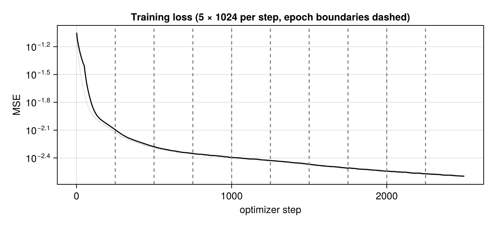
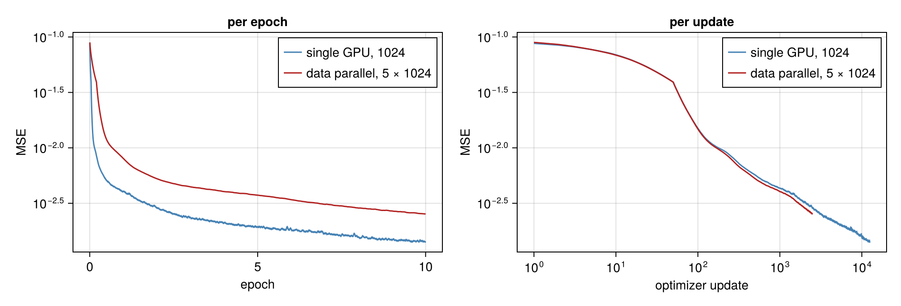
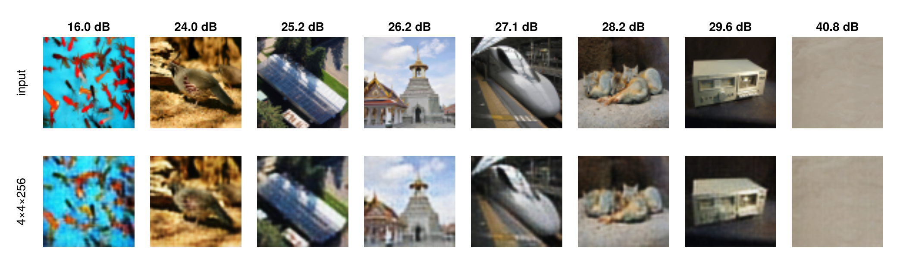
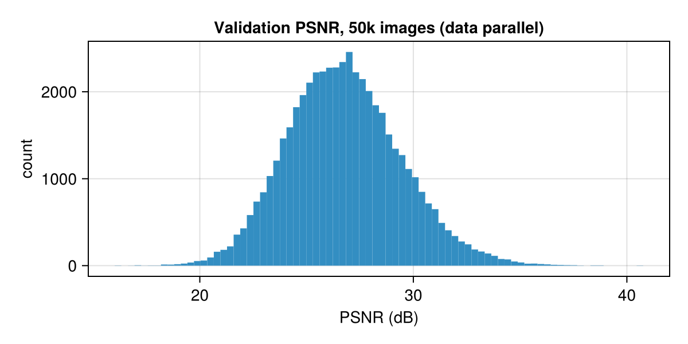

# ImageNet Autoencoder: Simulated Data Parallelism

This machine has one GPU. The question is what $N$-way data-parallel training of the
[autoencoder](Auto%20Encoder.md) would cost, and whether one GPU can answer that quantitatively.

It can, because synchronous data-parallel SGD is a statement about arithmetic, not hardware. The $N$
local gradients are all evaluated at the same $\theta_t$, so running the replicas one after another
on one card produces the same parameter update as running them simultaneously on $N$ cards. Only
wall-clock time differs, and wall-clock time can be measured phase by phase and reassembled.

The model, data loader, batch extraction and loss are those of [Auto Encoder.md](Auto%20Encoder.md)
(`src/shared.jl`). Only the optimizer step differs.

| script | does |
|---|---|
| [`src/data_parallel/common.jl`](src/data_parallel/common.jl) | $N = 5$, micro-batch 1024, the all-reduce (`avg_grads`), synchronized timing, tree helpers |
| [`src/data_parallel/verify.jl`](src/data_parallel/verify.jl) | arithmetic checks on one global batch |
| [`src/data_parallel/train.jl`](src/data_parallel/train.jl) | the data-parallel run (10 epochs, timed per phase, saves the model), the baseline run, reassembly, comparison |
| [`src/data_parallel/reconstruct.jl`](src/data_parallel/reconstruct.jl) | validation quality of the data-parallel model and its figures |

Run from `autoencoder_io/`: `julia --project src/data_parallel/verify.jl` (~1 min), then
`julia --project src/data_parallel/train.jl` (~8 min; append a step count, e.g. `20`, for a quick pass), then
`julia --project src/data_parallel/reconstruct.jl`. The evaluation code is shared with the single-GPU model
(`src/evaluate.jl`).

## Synchronous data-parallel SGD

With $N$ workers and local batch size $B$, one optimizer step is

$$\theta_{t+1} = \theta_t - \eta\, U\!\left(\bar g\right), \qquad \bar g = \frac{1}{N}\sum_{r=1}^{N} \nabla_\theta \mathcal{L}(\theta_t;\, \mathcal{B}_r), \qquad |\mathcal{B}_r| = B$$

where $U$ is the optimizer's update rule, the map from a gradient to a step: $U(g) = g$ for plain
SGD; for Adam (used here) $U(g) = \hat m_t / (\sqrt{\hat v_t} + \epsilon)$, where $m_t$ and $v_t$ are
running averages of $g$ and $g^2$ with bias corrections $\hat m_t = m_t/(1-\beta_1^t)$,
$\hat v_t = v_t/(1-\beta_2^t)$. Adam's $U$ is stateful, so data parallelism needs every worker to
hold the same optimizer state as well as the same $\theta_t$. It does, because the state starts
identical and every worker updates it with the same $\bar g$. Every worker holds the same $\theta_t$, sees a
different slice $\mathcal{B}_r$ of the global batch, and computes a local gradient. An all-reduce
averages them, and every worker applies the same $\bar g$ with the same optimizer state, so all $N$
copies stay identical. It is one model trained with batch $NB$, with the gradient computation split
$N$ ways.

Here $N = 5$ and $B = 1024$, so a global batch is 5120 images and an epoch is 250 optimizer steps.
Each shard holds $125 = 5^3$ batches of 1024, so 5 divides it exactly and every epoch covers the
same 1,280,000 images as the single-GPU model (1250 steps of 1024).

### Three primitives

| step | real DDP | here |
|---|---|---|
| scatter | each rank reads its own slice | the global batch is cut into 5 micro-batches |
| all-reduce | NCCL ring over NVLink / PCIe | leafwise mean of 5 gradient trees, on-device (`avg_grads`) |
| update | every rank applies $\bar g$ to its own copy, with its own (identical) Adam state | one Adam step on a master copy |
| broadcast | not needed after initialization | `fmap(copy, …)` of the master into each replica |

In real DDP the replicas stay identical because every rank applies the same update to the same
state; weights are broadcast once at construction and only gradients are all-reduced afterwards.
Here the update runs once, on the master, and is copied into the replicas. Both end with all
copies at $\theta_{t+1}$. The per-step broadcast is redundant on purpose: it keeps the mechanism
visible, and timing it shows what a parameter-server design would pay. The timing model drops it.

`avg_grads` passes `nothing` through: Zygote returns `nothing` as the gradient of parameter-free
layers (`relu`, `sigmoid`), and those leaves have nothing to average.

### Related schemes

On one GPU, the data-parallel run is **gradient accumulation**: 5 sequential forward/backward passes
of 1024, gradients averaged, one update. That is the standard way to get a large-batch update when
the batch does not fit in memory at once.

A single forward pass over all 5120 images, with the loss split 5 ways afterwards, is *not* the same:
the mean of 5 slice means is the overall mean, so it is just batch-5120 training, and its BatchNorm
normalizes over 5120. Normalizing over virtual sub-batches of 1024 inside a single 5120 pass is
**Ghost Batch Normalization** (Hoffer et al., 2017), which reproduces data parallelism's
per-replica statistics in one pass.

## Arithmetic checks

`src/data_parallel/verify.jl`, on one global batch of 5120 images from the first shard.

### Averaged micro-batch gradient vs one large batch

| | loss |
|---|---:|
| 5 replicas × 1024 | 0.088467, 0.087098, 0.089458, 0.091408, 0.090304 |
| mean of replicas | 0.089347 |
| single batch of 5120 | 0.089346 |

The leafwise mean of the 5 local gradients differs from the single 5120-image gradient by
$3.4\times10^{-4}$ relative to the largest gradient entry. They are *not* equal, and the reason is
**BatchNorm**: each replica normalizes over its own 1024 samples, the large batch over all 5120.
This is real and well known, and is what `SyncBatchNorm` exists to remove. The claim that matters
is a different one: that 5 sequential replicas equal 5 *simultaneous* GPUs.

The script also checks that `avg_grads` is the leafwise mean, not the sum, against an independent
computation. It matches exactly.

### Order independence

If there is no data dependency between replicas within a step, the order in which they are visited
cannot matter. Two invariants are checked:

1. **Every replica holds the master $\theta_t$ when its gradient is taken.** Measured drift is
   exactly 0. If the broadcast were wrong the replicas would drift apart, the gradients would be
   taken at different points, and the simulation would model nothing.
2. **Visiting the replicas in reverse changes nothing beyond noise.** The noise floor comes from
   running the *same* order twice:

| comparison | $\max \lvert\Delta\bar g\rvert / \max\lvert\bar g\rvert$ |
|---|---:|
| same order, run twice | $2.1\times10^{-7}$ |
| replica order reversed | $1.9\times10^{-7}$ |
| summation order of the 5 gradients reversed | $8.6\times10^{-8}$ |

Reversing the order lands inside the run-to-run noise. The noise itself is 1–2 ulps of Float32
($\varepsilon = 1.19\times10^{-7}$), from cuDNN backward kernels that accumulate in a
nondeterministic order (atomics). `CUDA.PEDANTIC_MATH` does not remove it (2.5e-7 either way).
So the sequential loop *is* the parallel step, up to the same last-bit nondeterminism two runs of
either would show. The update is not bit-reproducible on this stack in any case.

After one Adam step, parameters from two identical runs differ by up to $5.7\times10^{-5}$ (with
$\eta = 10^{-3}$). Adam's first step is $\approx \eta\,\bar g/\lvert\bar g\rvert$ per coordinate, so a
last-bit change in a near-zero gradient component can move that coordinate by up to $\eta$. This is
amplified noise, not a dependency on order.

## Timing model

One GPU runs the 5 replicas back to back, so a simulated step costs

$$t_{\text{seq}} = \sum_{r=1}^{N}\bigl(t^{\text{copy}}_r + t^{\text{grad}}_r\bigr) + t_{\text{reduce}} + t_{\text{update}} + t_{\text{bcast}}$$

On $N$ GPUs the per-replica terms run concurrently, the on-device average becomes an inter-GPU
all-reduce, and the broadcast disappears:

$$t_{\text{par}} = \max_{r}\bigl(t^{\text{copy}}_r + t^{\text{grad}}_r\bigr) + t_{\text{allreduce}} + t_{\text{update}}$$

$t_{\text{allreduce}}$ is the only term that cannot be measured on one card, so it is modelled. A ring
all-reduce over $N$ GPUs takes $2(N-1)$ hops and moves $2Ps(N-1)/N$ bytes per GPU, for $P$
parameters of $s$ bytes:

$$t_{\text{allreduce}} = \underbrace{2(N-1)\,\alpha}_{\text{latency}} + \underbrace{\frac{2(N-1)}{N}\cdot\frac{Ps}{\beta}}_{\text{bandwidth}}$$

| | |
|---|---:|
| parameters $P$ | 777,987 (3.11 MB as Float32) |
| moved per GPU per step | 4.98 MB |
| latency, 8 hops at $\alpha = 5$ µs | 40 µs |
| transfer at $\beta = 64$ GB/s (PCIe 5.0 x16) | 78 µs |
| **all-reduce** | **0.118 ms** |

The payload is small enough that latency is half the cost, so both terms are kept. Against a
forward/backward of ~18 ms the all-reduce is negligible, which also makes the result insensitive to
NVLink vs PCIe.

Every measured phase is bracketed by `CUDA.synchronize()` (`timed` in `src/data_parallel/common.jl`), so it
records GPU execution and not just kernel launch. In the data-parallel run those syncs are also
needed for correctness: all replicas stage through one device buffer, so replica $r$'s backward
pass has to finish before replica $r+1$ overwrites it.

## The data-parallel run

5 replicas, global batch 5120, 10 epochs. Epoch 1 is excluded from the timings (JIT compilation and
first touch of the mmap pages). Mean per optimizer step over the 2,250 steps of epochs 2–10:

| phase | ms per step | per replica |
|---|---:|---:|
| extract + H→D copy, ×5 | 24.82 | 4.96 |
| forward + backward, ×5 | 89.05 | 17.81 |
| all-reduce (on-device mean) | 1.85 | |
| master update (Adam) | 0.83 | |
| broadcast, ×5 (free in real DDP) | 0.62 | |
| **step** | **117.28** | |

### Reassembled as 5 GPUs

| term | ms |
|---|---:|
| slowest replica, $\max_r(t^{\text{copy}}_r + t^{\text{grad}}_r)$ | 27.32 |
| ring all-reduce (modelled) | 0.12 |
| master update | 0.83 |
| **step** | **28.27** |

That is 250 × 28.27 ms = **7.1 s per epoch** on 5 GPUs.

This is a **conservative** figure. Each replica's copy and forward/backward are timed with syncs on
both sides, so they add up serially: 5.0 + 17.8 ms. In the training loop of
[Auto Encoder.md](Auto%20Encoder.md) the next batch's extraction and copy overlap the previous step's
kernels, and a full 1024-image step takes 20.0 ms. A real rank running that loop would need
$\approx 20.0 + 0.12 + 0.83 \approx 21$ ms per step, i.e. ~5.2 s per epoch, close to the ideal
$5\times$.

What the model does not include:

- **stragglers:** the step waits for the slowest rank; the replicas here are assumed balanced
- **host contention:** 5 GPUs each pulling 50 MB per step means ~12 GB/s of H→D traffic and 5
  concurrent batch extractions sharing the CPU, memory bandwidth and PCIe root complex
- **launch contention and NCCL overheads** beyond the latency/bandwidth model

It is a ceiling, not a benchmark.

## The baseline run

The normal training loop itself: `train_normal` in `src/shared.jl`, the function
`src/normal/train.jl` runs. It runs for 2 epochs in the same process right after the data-parallel
run, so both share warm-up history, page-cache state and GPU clocks. Only its
steady-state epoch is used.

| | baseline | data parallel, $N = 5$ |
|---|---:|---:|
| images per optimizer step | 1024 | 5120 |
| optimizer steps per epoch | 1250 | 250 |
| ms per step, 1 GPU | 20.0 | 117.3 |
| epoch, 1 GPU | 25.0 s | 29.3 s |
| epoch, 5 GPUs (reassembled) | | **7.1 s** |

- **On one GPU the simulation is 17% slower than the baseline.** It does the same forward/backward
  work, plus the reduce and broadcast, and every phase is synchronized, so the copy never overlaps
  compute. That is the expected sign, and it is why the output of the simulation is the reassembled
  time and not its wall-clock.
- **On 5 GPUs the reassembled epoch is 3.5× faster** than the baseline (7.1 s vs 25.0 s), as a
  conservative ceiling, rising to ~4.8× with the training loop's copy/compute overlap.

## Reconstruction quality

`src/data_parallel/reconstruct.jl` evaluates the data-parallel model after 10 epochs exactly as the single-GPU
model is evaluated in [Auto Encoder.md](Auto%20Encoder.md): test-mode BatchNorm, all 50,000
validation images, per-image MSE and $\text{PSNR} = -10\log_{10}\text{MSE}$.

| | data parallel, $5\times1024$ | single GPU, 1024 |
|---|---:|---:|
| optimizer updates in 10 epochs | 2,500 | 12,500 |
| train loss, epoch 10 | 0.00259 | 0.00145 |
| val MSE, mean / median | 0.00252 / 0.00216 | 0.00137 / 0.00114 |
| **val PSNR, mean** | **26.77 dB** | **29.54 dB** |
| val PSNR, 10th / 90th percentile | 23.48 / 30.23 dB | 25.99 / 33.24 dB |

The same training losses, both models, against epochs and against optimizer updates (50-step moving
averages; the bend near update 50 is where the averaging window fills):

**Per epoch, the data-parallel model is behind**: 2.8 dB lower PSNR, 1.8× the MSE. It sees the same
images but makes 5× fewer parameter updates, at the same learning rate.

**Per update, the two curves nearly coincide.** At update 2,500 the data-parallel loss is 0.00259
against ≈0.0034 for the single-GPU model: somewhat better, nowhere near the 5× more images behind
each update. Averaging 5× more images cuts the gradient's variance 5×, but at $\eta = 10^{-3}$ with
Adam that barely changes how far each step goes. Training here is limited by the **number of
updates**, not by gradient noise, so fewer, cleaner updates lose per epoch. Matching the single-GPU
loss per epoch would take the usual large-batch remedies, which turn the cleaner gradient into
longer steps: scale the learning rate with the global batch ($\eta \to N\eta$) and warm it up
(Goyal et al., 2017). The learning rate is deliberately unscaled here.

The grid picks 8 validation images spanning the PSNR range, worst to best, as in
[Auto Encoder.md](Auto%20Encoder.md). The pattern is the same, with more blur: the worst image
(16.0 dB) is a tank of small goldfish whose fins and outlines dissolve into colour, and the best
(40.8 dB) is a nearly flat texture. In between, layout and colour survive while texture and edges
soften further than in the single-GPU model: the quail's plumage, the bullet train's lettering and
the station structure, the temple's detail, the sleeping foxes' fur.

## Is this the same as synchronous SGD?

Yes, by definition. Synchronous data-parallel SGD *is* the update

$$\theta_{t+1} = \theta_t - \eta\, U\!\left(\frac{1}{N}\sum_{r=1}^{N}\nabla_\theta\mathcal{L}(\theta_t;\,\mathcal{B}_r)\right)$$

and nothing in that expression mentions a device. The $N$ gradients are evaluated at the same
$\theta_t$, so they have no data dependency on each other, and independent work can be executed in
any order, including sequentially. A 5-GPU run and this loop produce the same $\theta_{t+1}$ up to
floating-point nondeterminism, which the order check above measures at the level of run-to-run
noise.

The simulation is exact for the mathematics and approximate only for the timing.

### What it is *not* the same as

1. **One batch of $NB$.** BatchNorm normalizes per replica, over $B$ samples, not over $NB$. The
   averaged-gradient check measures the gap ($3.4\times10^{-4}$). `SyncBatchNorm` closes it at the cost
   of one extra all-reduce per BatchNorm layer.
2. **$N$ sequential SGD steps of batch $B$.** This is one step on an averaged gradient, so per epoch it
   makes $N$ times fewer parameter updates. [Reconstruction quality](#reconstruction-quality) shows
   the consequence.
3. **A measurement of multi-GPU performance.** $t_{\text{par}}$ assumes balanced replicas, models the
   all-reduce, and ignores host and interconnect contention.
4. **A copy of every replica's BatchNorm statistics.** Running means and variances are state, not
   parameters, so they are not all-reduced. The data-parallel run keeps replica 1's and discards the
   other four, the same as PyTorch DDP's default (`broadcast_buffers=True` pushes rank 0's buffers at
   every forward).

## Takeaways

- **The arithmetic of synchronous data parallelism carries over to one GPU.** Replicas stay exactly
  in sync, and visiting them in a different order changes the update no more than re-running the
  same order does.
- **Communication is not the cost for this model.** At 0.78 M parameters the ring all-reduce is
  0.12 ms against an ~18 ms forward/backward, so the answer barely depends on the interconnect.
- **Five GPUs would cut an epoch from 25.0 s to 7.1 s** by the conservative reassembly, and to about
  5 s with the copy/compute overlap the single-GPU loop already has. Host-side contention from five
  concurrent input pipelines is the main thing the model leaves out.
- **Time is not convergence.** With the learning rate unscaled, 10 data-parallel epochs reach
  26.8 dB against 29.5 dB for the single-GPU model. Per update the two models learn at almost the
  same rate, so 5× fewer updates per epoch costs accuracy per epoch; getting it back needs a
  learning rate scaled to the global batch.
