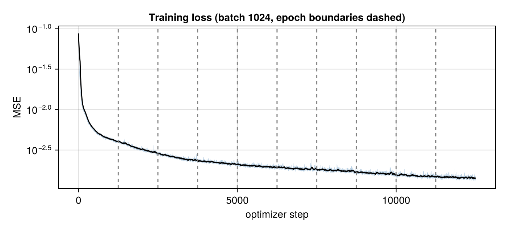
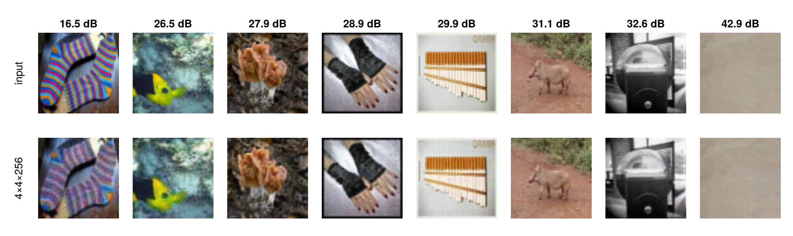
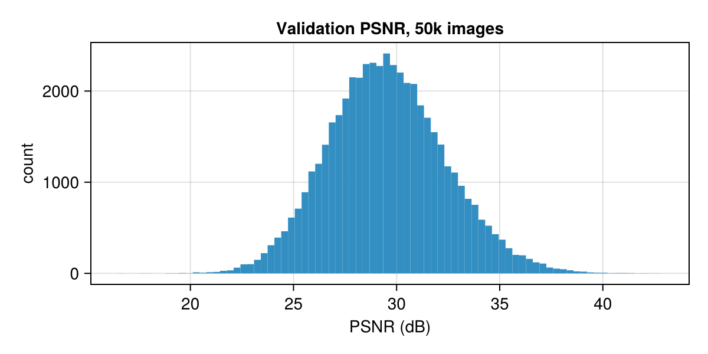

# ImageNet Autoencoder: Making the GPU the Bottleneck

Train a convolutional autoencoder on all of ImageNet-64 (1,281,167 images, 10 epochs) and keep
data loading off the critical path. Unpickling the dataset from Python costs ~3 min per pass, so
30 min of pure IO over 10 epochs. The question is whether that cost can be removed entirely,
so that the GPU sets the pace.

Code lives in `src/`; this document only reports what it produces.

| script | does |
|---|---|
| [`src/preprocess.jl`](src/preprocess.jl) | one-time pickle → mmap shard conversion ([Image Preprocess.md](Image%20Preprocess.md)) |
| [`src/shared.jl`](src/shared.jl) | shard loader and model definition, included by everything else |
| [`src/normal/train.jl`](src/normal/train.jl) | 10-epoch training run, checkpoints, per-step loss CSV, IO accounting |
| [`src/normal/reconstruct.jl`](src/normal/reconstruct.jl) | held-out reconstruction quality of the final checkpoint, and all figures |
| [`src/normal/profile.jl`](src/normal/profile.jl) | the training loop with NVTX labels, for an Nsight Systems capture |

Run from `autoencoder_io/`, e.g. `julia --project src/normal/train.jl`. The data-parallel
scripts are in `src/data_parallel/` ([Auto Encoder - Data Parallel.md](Auto%20Encoder%20-%20Data%20Parallel.md)).

## Data loading

The preprocessed shards (63 GB of Float32 in `build/train/Xs.ser`) are memory-mapped rather than
read. `MMapReader` ([`lib/utils.jl`](lib/utils.jl)) maps the file once and returns each shard as
`reshape(reinterpret(Float32, view(buf, a:b)), 64, 64, 3, Nₖ)`, a view into the mapping, so
"loading" means parsing ten small headers:

```
0.174 s   (369.5 k allocations, 28.7 MiB, 91% compilation)   →   1,281,167 images
```

Nothing is read at that point. Pixels are faulted in from NVMe by the OS the first time a batch
touches them, and from the page cache after that.

## Model

Defined in `build_model()`, [`src/shared.jl`](src/shared.jl). The model is a plain convolutional
encoder–decoder: four stride-2 convolutions down, four stride-2 transposed convolutions up, all
3×3, with no skip connections. Skips (U-Net style) would let information route *around* the
latent, which defeats the point of measuring what survives the bottleneck.

$$64{\times}64{\times}3 \;\to\; 32{\times}32{\times}32 \;\to\; 16{\times}16{\times}64 \;\to\; 8{\times}8{\times}128 \;\to\; \underbrace{4{\times}4{\times}256}_{\text{latent}} \;\to\; 8{\times}8{\times}128 \;\to\; 16{\times}16{\times}64 \;\to\; 32{\times}32{\times}32 \;\to\; 64{\times}64{\times}3$$

### Layers

Shapes are W×H×C per image (Lux/Julia order WHCN, batch last).

| # | layer | output | parameters | MACs / image |
|---:|---|---|---:|---:|
| | **encoder** | | | |
| 1 | Conv 3×3, 3→32, stride 2, pad 1 · BN · ReLU | 32×32×32 | 896 + 64 | 0.88 M |
| 2 | Conv 3×3, 32→64, stride 2, pad 1 · BN · ReLU | 16×16×64 | 18,496 + 128 | 4.72 M |
| 3 | Conv 3×3, 64→128, stride 2, pad 1 · BN · ReLU | 8×8×128 | 73,856 + 256 | 4.72 M |
| 4 | Conv 3×3, 128→256, stride 2, pad 1 · BN · ReLU | **4×4×256** | 295,168 + 512 | 4.72 M |
| | **decoder** | | | |
| 5 | ConvT 3×3, 256→128, stride 2, pad 1, outpad 1 · BN · ReLU | 8×8×128 | 295,040 + 256 | 4.72 M |
| 6 | ConvT 3×3, 128→64, stride 2, pad 1, outpad 1 · BN · ReLU | 16×16×64 | 73,792 + 128 | 4.72 M |
| 7 | ConvT 3×3, 64→32, stride 2, pad 1, outpad 1 · BN · ReLU | 32×32×32 | 18,464 + 64 | 4.72 M |
| 8 | ConvT 3×3, 32→3, stride 2, pad 1, outpad 1 · sigmoid | 64×64×3 | 867 | 0.88 M |
| | **total** | | **777,987** | **30.1 M** |

MAC = multiply–accumulate ($a \leftarrow a + w x$, i.e. 2 FLOPs), counted for one forward pass of
one image: $H_\text{out}W_\text{out}c_\text{out}\cdot k^2 c_\text{in}$ for a convolution and
$H_\text{in}W_\text{in}c_\text{in}\cdot k^2 c_\text{out}$ for a transposed convolution.

Parameters are written as conv weights + bias ($9\,c_\text{in}c_\text{out} + c_\text{out}$), plus
BatchNorm's scale and shift ($2c$). The two halves are almost exactly mirror images: 389,376
parameters in the encoder and 388,611 in the decoder, 15.04 M MACs each. BatchNorm also carries
1,408 running-statistic values (mean and variance per channel), which are state, not parameters.

## Training

Adam with learning rate $\eta = 10^{-3}$ (Optimisers.jl defaults $\beta_1 = 0.9$,
$\beta_2 = 0.999$, $\epsilon = 10^{-8}$), MSE loss, batch 1024, 10 epochs. Shard order and batch order within each shard
are shuffled every epoch; the ragged tail of each shard is dropped, so an epoch is 1250 steps.
Each batch is copied from a `view` of the mmap into one preallocated host buffer, then into one
preallocated device buffer, so nothing is allocated per step. That choice is worth 1.7× in
throughput; see [Batch extraction](#batch-extraction).

| epoch | loss | s | img/s |
|---:|---:|---:|---:|
| 1 | 0.00735 | 69.7 | 18,369 |
| 2 | 0.00337 | 24.4 | 52,377 |
| 3 | 0.00255 | 25.0 | 51,265 |
| 4 | 0.00221 | 24.4 | 52,383 |
| 5 | 0.00200 | 25.0 | 51,191 |
| 6 | 0.00187 | 24.7 | 51,885 |
| 7 | 0.00176 | 24.3 | 52,674 |
| 8 | 0.00163 | 25.6 | 50,046 |
| 9 | 0.00152 | 24.6 | 52,082 |
| 10 | 0.00145 | 25.2 | 50,882 |

Total: 299 s, 327.7 M allocations, 25.3 GiB allocated, 3.6% GC time (Julia 1.12, RNG seed 0).



Steady state is 24.8 s/epoch, about 52k img/s or 19.8 ms per step. The loss is still falling at
epoch 10, so the model has not converged.

Epoch 1 runs 2.8× slower than the rest, for two reasons. The first steps pay for JIT compilation.
And epoch 1 is the only epoch that first-touches all 63 GB of the mmap: pages come from NVMe (or the
ZFS ARC) and are faulted into the process. Epochs 2–10 read from RAM only if the ZFS ARC holds the
whole 63 GB file. The ARC sizes itself adaptively (up to 250 GiB on this 256 GB box) and can be
smaller than the file, e.g. 44 GiB right after a boot, in which case some batches come from NVMe at
~0.6 GB/s. The epoch times above were measured with a warm, large ARC.

## IO accounting

One image is $64\cdot64\cdot3\cdot4 = 49{,}152$ bytes, so one batch is 50.3 MB, and 10 epochs move

$$12{,}500 \text{ batches} \times 50.3\,\text{MB} = 629\,\text{GB}$$

from host to device. Over the 292.8 s of epochs that averages 2.15 GB/s; in steady state it is
$63\,\text{GB} / 24.8\,\text{s} = 2.54$ GB/s. Both figures are far below PCIe 5.0 x16 (~64 GB/s),
so host → device bandwidth does not limit training.

The whole run allocates 25.3 GiB. Taking each batch as `Xk[:, :, :, i:j]` instead of copying from a
view would add a fresh 50 MB array per step:

$$12{,}500 \times 50.3\,\text{MB} = 586\,\text{GiB}$$

## Nsight Analysis

[`src/normal/profile.jl`](src/normal/profile.jl) runs `train.jl`'s loop body unchanged, with each phase wrapped
in an NVTX range. It warms up for 60 steps, touches every batch it is about to record (so the
data is in RAM, as in training epochs 2+), then records `PROFILE_STEPS` steps (default 200) inside
`CUDA.@profile external=true`, which keeps compilation out of the trace.

Both profilers read GPU performance counters, which the driver restricts to root unless the
`nvidia` module is loaded with `NVreg_RestrictProfilingToAdminUsers=0` (set on this box in
`/etc/modprobe.d/nvidia-profiling.conf`).

**Nsight Systems**, the whole-step timeline plus 10 kHz hardware metrics →
`results/train_profile.nsys-rep`:

```
nsys profile --capture-range=cudaProfilerApi --capture-range-end=stop \
     --trace=cuda,nvtx,osrt --gpu-metrics-devices=all \
     -o results/train_profile julia --project src/normal/profile.jl
```

**Nsight Compute**, per-kernel counters for the first launch of each kernel in one step →
`results/kernels.ncu-repz`:

```
JULIA_CUDA_HARD_MEMORY_LIMIT=8GiB PROFILE_STEPS=1 \
ncu --profile-from-start off --kernel-id '::regex:.*:1' --set full \
    -o results/kernels julia --project src/normal/profile.jl
```

The memory cap matters. Kernel replay saves and restores every device allocation the process
holds, and without the cap Julia's CUDA pool grows to ~95 GB and replay fails (`LaunchFailed`).

### Where a step goes

CPU time per step, by NVTX range, and the fraction of that time the GPU is doing anything (kernels,
copies or memsets). With metrics sampling on, a step takes 21.0 ms, against 19.8 ms untraced:

| phase | code | CPU ms | GPU busy during it |
|---|---|---:|---:|
| slice | `copyto!(xb_host, view(Xk, …))` | 3.2 | 96% |
| H2D | `copyto!(xb_gpu, xb_host)` | 8.3 | 99% |
| fwd+bwd | `Zygote.pullback` + `back` | 8.3 | 81% |
| adam | `Optimisers.update` | 1.2 | 98% |
| **step** | | **21.0** | **91%** (19.1 ms) |

The step is **GPU-bound**. Kernel launches are asynchronous, so the CPU extracts batch $k+1$ while
the GPU is still running step $k$'s kernels. The H2D phase is mostly waiting: the DMA itself takes
2.1 ms (50.3 MB at 24 GB/s), and the remaining ~6 ms is the synchronous `cudaMemcpy` blocking until
the previous step's kernels finish. A CPU blocked on the GPU is what a GPU-bound loop looks like
from the host.

### Batch extraction

How a batch is pulled out of the mmap is the single largest performance decision in the loop.
A microbenchmark on one shard, with its pages already resident:

| extraction | ms / batch | GB/s |
|---|---:|---:|
| `Xk[:, :, :, i:j]`, a fresh array every time | 23.2 | 2.2 |
| `copyto!(buf, view(Xk, :, :, :, i:j))`, reused `buf` | **2.7** | **18.8** |

The memcpy costs 2.7 ms in both cases. A fresh array adds **~20 ms of allocation**: 50 MB of new
memory that the kernel faults in and zeroes page by page,

$$\frac{50.3\ \text{MB}}{4\ \text{KiB}} \approx 12{,}300\ \text{page faults per step}$$

and then the GC reclaims it. In the training loop those 20 ms would land on the critical path,
with the GPU idle while it waits for data, and throughput would drop to ~30k img/s.

The view cannot go to the GPU directly: `copyto!(xb_gpu, view(Xk, …))` falls through to Base's
element-by-element `copyto!`, which CUDA.jl rejects as scalar indexing. The mmap wrappers
(`SubArray` of `ReshapedArray` of `ReinterpretArray`) hide the fact that the block is contiguous.
Copying into the dense `xb_host` first is what turns the transfer into a single `cudaMemcpy`.

### GPU utilization

"Busy" means *some* kernel is running. The hardware metrics show how much of the GPU that kernel
actually uses, averaged over the 200 profiled steps:

| metric | value | meaning |
|---|---:|---|
| GR Active | 84% | the GPU has work |
| SMs Active | 44% | SMs with at least one resident warp |
| SM Issue | 12% | instruction-issue slots used |
| Tensor Active | 4% | tensor-core pipe active |
| Compute warps in flight | 22% of max | occupancy |
| DRAM read / write | 19% / 16% of peak | memory bandwidth |
| PCIe RX | 7% of peak | host → device traffic |

The GPU is neither compute-bound (12% issue, 4% tensor) nor memory-bound (~35% of DRAM
bandwidth). It is **latency-bound**: most kernels are too small to occupy the card's 188 SMs.

### Kernels

17.0 ms of kernels per step, 230 launches, 49 distinct kernels (Nsight Systems):

| kernel | per step | share of kernel time |
|---|---:|---:|
| GPUArrays generic kernel (Julia broadcast / reduction) | 7 × 541 µs | 22% |
| cuDNN BatchNorm backward | 2 × 1.34 ms + 5 × 182 µs | 21% |
| cuDNN `nchwToNhwc` layout transposes | 36 × 42 µs | 9% |
| cuDNN BatchNorm forward (training) | 2 × 449 µs | 5% |
| convolution kernels (CUTLASS / cuDNN, TF32 tensor cores) | | the rest, each ≤ 5% |

107 of the 230 launches are tiny (< 10 µs) but total 0.13 ms, so launch overhead is negligible.

### Kernel analysis

Nsight Compute, first launch of each kernel name in one step. *SM%* and *Mem%* are throughput as a
fraction of peak (the speed-of-light numbers); *occ* is achieved occupancy, against the theoretical
limit set by registers and shared memory; *waves* is how many times the grid fills all 188 SMs.

| kernel | µs | grid × block | waves | SM% | Mem% | occ / theor. | TC% | bound |
|---|---:|---|---:|---:|---:|---|---:|---|
| BatchNorm backward | 1329 | 32 × 512 | 0.06 | 2 | 30 | 33 / 100 | 0 | latency |
| BatchNorm forward | 515 | 32 × 512 | 0.06 | 9 | 46 | 32 / 100 | 0 | latency |
| conv wgrad (`wgrad_alg0`) | 316 | 2048 × 64 | 0.91 | 11 | 41 | 38 / 50 | 0 | latency |
| conv dgrad (`dgrad_engine`) | 286 | 32768 × 64 | 17.4 | 26 | 70 | 40 / 42 | 0 | memory |
| conv (CUTLASS, TF32) | 186 | 4096 × 128 | 21.8 | 43 | 39 | 8 / 8 | 45 | latency |
| conv fprop (implicit GEMM, TF32) | 177 | 2048 × 128 | 10.9 | 45 | 68 | 8 / 8 | 48 | memory |
| `nchwToNhwc` transpose | 161 | 32768 × 256 | 29.1 | 11 | 87 | 75 / 100 | 0 | memory |
| cuDNN elementwise (`op_generic_tensor`) | 159 | 32768 × 256 | 29.1 | 10 | 87 | 91 / 100 | 0 | memory |
| conv fprop (`implicit_convolve_sgemm`) | 154 | 32768 × 64 | 10.9 | 35 | 81 | 63 / 67 | 0 | memory |
| Julia reductions (`multigroup`, `mapreduce`, `by_block`) | 28–77 | 256 × 256 | 0.23 | 5–7 | 37–89 | 23 / 100 | 0 | latency |
| Julia broadcast (`broadcast_cartesian`) | 58 | 11264 × 768 | 30.0 | 69 | 57 | 86 / 100 | 0 | compute |

What the table says:

- **BatchNorm is the clearest case.** cuDNN's NCHW BatchNorm launches one block per channel, so a
  32-channel layer gets a grid of **32 blocks on 188 SMs**: at most 17% of the GPU can work on it,
  and each block reduces $32\cdot32\cdot1024 \approx 10^6$ values alone. SM throughput is 2–9%.
  The two 128-channel BatchNorm backward launches are the most expensive kernels in the step.
  Because the grid is set by channels, not images, a larger batch does not widen it: each block
  just reduces more values. Throughput per image stays the same at any batch size (batch 16384
  runs at ~47k img/s), while optimizer steps per epoch drop 16×. Batch 1024 is the right size.
- **The Julia reductions have the same problem.** 256-block grids fill a quarter of one wave.
- **The convolutions use tensor cores but sit at 8% occupancy.** That is the *theoretical* limit
  for those kernels (register and shared-memory use per block), so the tensor pipes are active
  45–68% of the time but are fed by few warps. They are not the bottleneck.
- **The layout transposes and cuDNN elementwise kernels run as fast as memory allows** (87% of
  peak). They are efficient; their cost is that they exist. Lux stores activations as WHCN (NCHW in
  cuDNN's terms), and cuDNN's tensor-core convolutions want NHWC, so every convolution pays a
  transpose on the way in and out.

The Julia generic kernel that takes 22% of kernel time in Nsight Systems averages 541 µs there, but
its first launch, the one Nsight Compute profiled, is a 28 µs instance. Its large instances are not
in this table.

The remaining speed is all kernel-side, and none of it is a one-line change: a channels-last layout
(no transposes), a BatchNorm implementation that parallelizes within a channel, or fewer, larger
kernels. For a 0.78 M-parameter model that already trains an epoch in 25 s, the data pipeline is the
part worth getting right, and it is.

## Reconstruction quality

`src/normal/reconstruct.jl` loads the epoch-10 checkpoint and runs it in test mode (BatchNorm using its
running statistics) over all 50,000 **validation** images, none of which were seen in training. It
reports per-image MSE and PSNR, with peak value 1:

$$\text{PSNR} = -10\log_{10}\text{MSE}\ \ \text{dB}$$

| | validation (50k) | train, epoch 10 |
|---|---:|---:|
| MSE, mean | 0.00137 | 0.00145 |
| MSE, median | 0.00114 | |
| PSNR, mean | 29.54 dB | |
| PSNR, 10th / 90th percentile | 25.99 / 33.24 dB | |

Validation MSE is slightly *below* the training loss, so there is no overfitting. The training
figure is averaged over epoch 10 while the weights were still improving, and it uses batch
statistics in BatchNorm, so the two are not perfectly comparable. Mean PSNR (29.5 dB) is higher
than the PSNR of the mean MSE ($-10\log_{10}0.00137 = 28.6$ dB): the log is concave, so Jensen's
inequality gives the gap.

The grid shows eight validation images chosen to span the PSNR range, worst to best. The top row is
the input, and the bottom row is the reconstruction from the $4{\times}4{\times}256$ latent.



What the bottleneck discards is high-frequency content. The worst image (16.5 dB) is knitted socks
with fine multicoloured stripes: the colours survive, but the stripes smear into a blur. The best
(42.9 dB) is an almost uniform texture with nothing to lose. In between, reconstructions keep the
layout, colour and large edges, but soften texture: the reef behind the fish, the fungus, the
knit of the gloves, the warthog's coat. Sharp, high-contrast edges such as the pan-flute pipes
and the parking meter survive better. That is what a 31×31-px receptive field per latent cell and
an MSE loss produce together.
MSE penalizes a sharp edge in the wrong place more than a blur in the right place, so the optimum
is the conditional mean, and the conditional mean is blurry.



The PSNR distribution is unimodal and roughly symmetric, with a long thin left tail: the
hardest images are high-texture ones like the socks.

## Compression ratio

Counted in values, the latent is exactly one third of the input:

$$\frac{4\cdot4\cdot256}{64\cdot64\cdot3} = \frac{4096}{12288} = \frac{1}{3}\qquad(3{:}1)$$

An $8{\times}8{\times}128$ latent would keep $8192/12288 = 2/3$ (1.5:1) and reconstructs noticeably
better; the scripts implement only the $4{\times}4{\times}256$ configuration.

That ratio measures **dimensionality, not bits**. ImageNet pixels are 8-bit, but the latent is
Float32:

$$\frac{4096 \times 32\ \text{bits}}{12288 \times 8\ \text{bits}} = \frac{131072}{98304} = \frac{4}{3}$$

Stored naively, the latent is *larger* than the original image. The 3:1 figure says the decoder
can rebuild 12,288 values from 4,096. To turn that into real compression, the latent would need to
be quantized and entropy-coded, which is what learned image codecs do. The latent comes out of a
ReLU, so it is non-negative and probably sparse, which would help an entropy coder. Neither the
sparsity nor the bits needed has been measured here.

## Takeaways

- **Loading is free.** Mapping the dataset takes 0.17 s, against ~3 min per pass to unpickle it.
  Once the page cache is warm, disk plays no part in the run.
- **Feeding is the one line that matters.** Copying each batch from a view into a reused buffer
  keeps the step GPU-bound: 52k img/s, GPU busy 92% of each step. Slicing a fresh array instead
  would allocate 50 MB per step and drop throughput to 30k img/s.
- **The GPU is busy but not working hard.** It has work 91% of the time but issues on 12% of its
  slots and uses its tensor cores 4% of the time. The kernels are latency-bound: BatchNorm runs
  32-block grids on 188 SMs, and the convolutions pay layout transposes on both sides. Faster
  training from here means kernel-level changes (channels-last, a different BatchNorm), not the
  loop.

[Auto Encoder - Data Parallel.md](Auto%20Encoder%20-%20Data%20Parallel.md) looks at what
splitting the optimizer step across replicas would cost.
