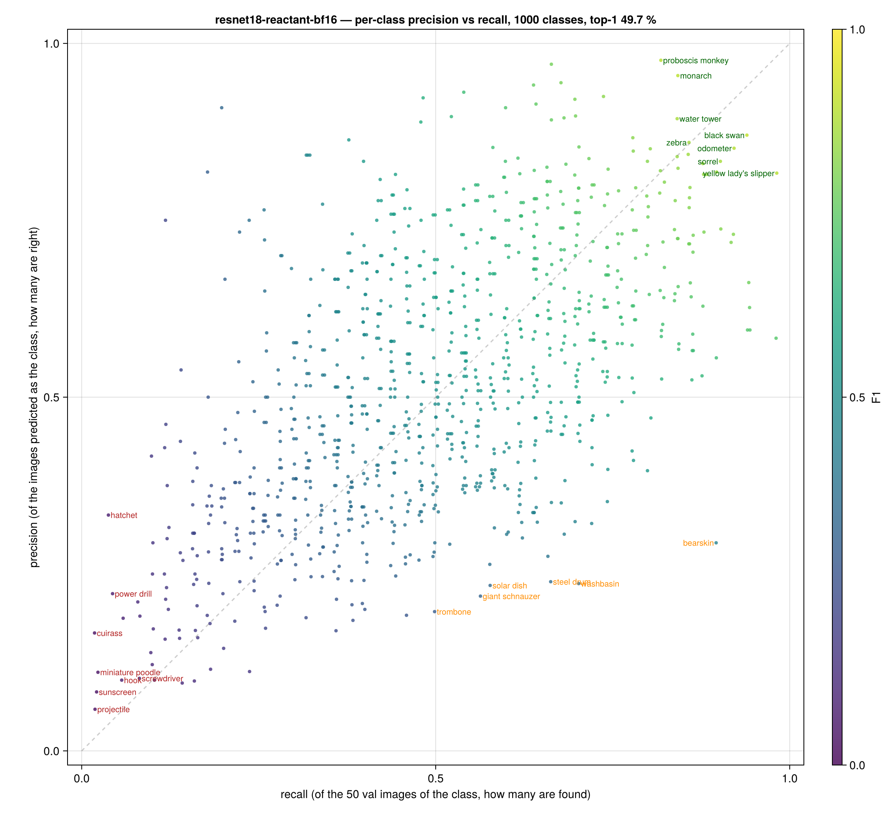

# ImageNet-64 classifier

A supervised classifier on ImageNet-64 (1000 classes, $64 \times 64$ images). It shares the data and
the loaders with the other `imagenet64` projects (`../utils/data.jl`, shards in `../build`); the
network, loss, training loop and evaluation are its own. Two networks share one training loop, head
and loss: a plain VGG-style baseline and a ResNet-18.

## Models

Selected with `MODEL=vgg` (default) or `MODEL=resnet18`, built by `build_model` in `src/model.jl`.
Both end in the same head (global average pooling, dropout 0.3, one linear layer), so they differ
only in the convolutional body.

### VGG

A VGG-style CNN, 5 200 296 parameters:

```
64²×3 → [64, 64] → maxpool → 32²×64 → [128, 128] → maxpool → 16²×128 → [256, 256] → maxpool → 8²×256
      → [512, 512] → global mean → 512 → dropout(0.3) → Dense → 1000 logits
```

Each `[c, c]` is a stage of two $3 \times 3$, stride-1 convolutions, each followed by BatchNorm and
ReLU (the convolutions have no bias; BatchNorm's $\beta$ replaces it).

- **Stride-1 convs inside a stage** compute features at full resolution before anything is discarded;
  two stacked $3 \times 3$ convs give a $5 \times 5$ receptive field per stage.
- **Max-pooling between stages** keeps the strongest response in each $2 \times 2$ window: the
  translation invariance a classifier wants (and an autoencoder must avoid).
- **Width doubles as resolution halves**, so every stage costs about the same FLOPs:
  $H W C^2$ is constant when $H, W$ halve and $C$ doubles.
- **Global average pooling plus one linear layer** is a small head, so the convolutional stack has to
  make the classes linearly separable.

### ResNet-18

ResNet-18 adapted to $64 \times 64$, 11 681 832 parameters, 17 convolutions plus the linear layer:

```
64²×3 → stem conv → 64²×64 → [64]×2 → 64² → [128]×2 /2 → 32² → [256]×2 /2 → 16² → [512]×2 /2 → 8²×512
      → global mean → 512 → dropout(0.3) → Dense → 1000 logits
```

Each `[c]` is a basic block,

$$y = \operatorname{relu}\big(F(x) + S(x)\big), \qquad F = \text{conv-BN-ReLU-conv-BN},$$

where the shortcut $S$ is the identity, or a $1 \times 1$ convolution + BatchNorm when the block
changes resolution or width. `/2` marks the first block of a stage, whose first convolution and
shortcut have stride 2.

- **The identity path** gives gradients a direct route back, $\partial y / \partial x = I + \partial F / \partial x$,
  and lets a block start as "do nothing". That is what makes depth trainable.
- **No stride-2 stem and no max-pool**, unlike the 224-pixel ResNet: at 64 px the first stage keeps
  full resolution, as in the VGG.
- **Strided convolutions downsample** instead of max-pooling.
- **About 2.6× the VGG's arithmetic** (~2.2 G vs 0.84 G multiply-adds per image), but only ~1.3×
  slower on the Blackwell: the VGG leaves most of the GPU idle, and the extra work fills it.

## Loss

Softmax cross-entropy from the logits $z \in \mathbb{R}^{1000 \times B}$ with one-hot targets $Y$:

$$
\ell = -\frac{1}{B} \sum_{i=1}^{B} \sum_{c=1}^{1000} Y_{ci} \log \operatorname{softmax}(z)_{ci},
\qquad
\operatorname{softmax}(z)_{ci} = \frac{e^{z_{ci}}}{\sum_{c'} e^{z_{c'i}}}
$$

Computed as a dense product $Y \odot \log\operatorname{softmax}(z)$ rather than by indexing, so the GPU
needs no gather or scatter. At initialization the prediction is near uniform, so
$\ell \approx \ln 1000 = 6.908$: the first sanity check.

## Data

The common ImageNet-64 shards (`../build/{train,val}`, 59 GB + 2.3 GB, written by
`../utils/preprocess.jl`, loaded by `../utils/data.jl`): 1 281 167 train images in 10
mmap'd shards and 50 000 val, labels $1 \ldots 1000$. Batches come from the common `DataLoader`
(`../utils/dataloader.jl`), and the training loop is just `for (x, y) ∈ loader`:

- each batch is **one** `read!` of $B \cdot 64 \cdot 64 \cdot 3 \cdot 4$ bytes straight from `Xs.ser`
  (no mmap page faults);
- a reader thread reads ahead into 4 reusable host buffers while the GPU trains (run `julia -t 4`);
- shuffling is by **chunks** of 16 consecutive batches: chunk order is reshuffled across all shards
  every epoch, batches inside a chunk are read in order, so reads stay large and sequential;
- ragged shard tails are dropped.

The same code is fast on both machines. Loading alone (CPU, warm cache, batch 1024) on the
Threadripper: **42 300 img/s** vs 13 500 img/s for the old mmap copy, far above what the GPU trains at.
On the NAS (60 GB of shards on spinning disks, 30 GB of RAM) it took training on the TITAN X from
~450 to ~950 img/s, GPU-bound.

## Precision

`PRECISION=fp32` (default) or `PRECISION=bf16`. BF16 is **mixed precision**: each step casts the
weights, BatchNorm statistics and input batch to BF16 and runs forward and backward there, while the
weights, Adam's moments and the BatchNorm statistics stay FP32 (`ce_grad_bf16` in `src/train.jl`,
`objective_bf16` in `src/train_reactant.jl`).

- **Weights stay FP32** because they accumulate many tiny updates. Near $|w| = 0.5$ one BF16 ulp is
  $2^{-8} \approx 3.9 \times 10^{-3}$, so a $10^{-3}$ Adam step would round away entirely.
- **The forward/backward pass tolerates BF16.** Its rounding ($\varepsilon = 2^{-7} \approx 0.8\%$) is
  transient and smaller than the minibatch noise SGD already has ($\sim 1/\sqrt{B}$). BF16 also keeps
  FP32's exponent range, so no loss scaling is needed.
- **Logits are cast to FP32 before the softmax**, whose exponentials and normalizing sum need range
  and precision.
- **All conversions run on the GPU.** Julia's CPU code for BF16 conversion crashes LLVM on this
  machine's Zen 4 CPU.
- **The head runs in FP32** in the eager path: only the convolutional body is cast to BF16. LuxLib's
  fused BF16 `Dense` (a cuBLASLt matmul with a bias epilogue) fails its algorithm search with
  `CUBLAS_STATUS_INVALID_VALUE`, and the head is ~0.5 M of the ~2.2 G multiply-adds per image.

- **Under Reactant the casts test for `TracedRArray{Float32}`.** Inside the trace an array's element
  type is `TracedRNumber{Float32}`, not an `AbstractFloat`, so `Lux.bf16` passes it through
  unchanged; Conv then promotes a BF16 input back to the FP32 weight type and the compiled program
  contains no BF16 op at all. `to_bf16` in `src/train_reactant.jl` casts every traced FP32 array,
  and the whole network, head included, runs in BF16 with FP32 logits.
- **BatchNorm statistics are BF16 reductions under Reactant.** XLA expands BatchNorm in its operand
  type, so $\sum x$ and $\sum x^2$ over $512 \cdot 64 \cdot 64$ values per channel accumulate in BF16.
  The 10-epoch run reaches the FP32 accuracy, so this costs nothing measurable here.

**BF16 on Reactant is the fastest configuration** (see [Speed](#speed)): 13 600 img/s, 2.8× Reactant
FP32 and 3.7× eager FP32, at the same accuracy and slightly ahead of PyTorch's best. Eager BF16 needs
cuDNN BatchNorm for BF16, which stock LuxLib lacks.

## Run

```bash
julia -t 4 --project src/train.jl                    # VGG, 10 epochs, batch 1024, Adam 1e-3
julia -t 4 --project src/train.jl 2 30               # smoke test: 2 epochs × 30 steps
BATCH=512 julia -t 4 --project src/train.jl          # batch 512 (fits the NAS's 12 GB TITAN X)
MODEL=resnet18 BATCH=512 julia -t 4 --project src/train.jl                  # ResNet-18
MODEL=resnet18 PRECISION=bf16 BATCH=512 julia -t 4 --project src/train.jl   # ResNet-18, BF16
```

After every epoch: val top-1 / top-5 (BatchNorm and dropout in test mode), a checkpoint in
`build/checkpoint<tag>/model_<epoch>.jld2`; at the end `results/train_{epochs,loss}<tag>.csv`. The
tag is empty for the default VGG/FP32 and otherwise names the model and precision
(`-resnet18`, `-resnet18-bf16`). A run given a step limit (the second argument) is a smoke test and
adds `-smoke` to the tag and to its TensorBoard run name, so it never overwrites a full run's files.

### Compiled backend: Reactant + Enzyme

`src/train_reactant.jl` trains the same model with the same recipe and TensorBoard tags, but compiles
the whole training step through MLIR to XLA (`reactant_device()`, `Training.single_train_step!` with
`AutoEnzyme()`), so XLA fuses BatchNorm, ReLU and residual adds and picks its own layouts. Lux
recommends it as its preferred GPU path.

```bash
MODEL=resnet18 BATCH=512 julia -t 4 --project src/train_reactant.jl                  # FP32
MODEL=resnet18 BATCH=512 PRECISION=bf16 julia -t 4 --project src/train_reactant.jl   # BF16
```

XLA compiles once per process: ~60–70 s for the training step and ~31 s for the evaluation forward
pass. Compiled programs have fixed shapes, so evaluation runs in batches of 1 000. Outputs carry a
`-resnet18-reactant[-bf16]` tag.

The loop reads each step's loss back one step late: reading it blocks until its step has finished,
and the one-step lag keeps a step queued on the GPU while the host loads, copies and dispatches the
next (~8 % in BF16, where the step is short).

### PyTorch reference

`python/torch_resnet18.py` is the same ResNet-18 (11 681 832 parameters), recipe, data (it reads the
`.ser` shards directly) and TensorBoard tags in PyTorch, as a yardstick for the Julia stack:

```bash
cd python
uv run --no-project --index https://download.pytorch.org/whl/cu130 \
    --with torch --with numpy --with tensorboard python -I torch_resnet18.py bench     # 6 configs
uv run ... python -I torch_resnet18.py train --precision bf16 --layout cl --compile    # 10 epochs
```

### Monitoring

Every run logs to TensorBoard under `build/tensorboard/`, against the global optimizer step:
`<model>[-bf16]-b<batch>-<time>/` for `train.jl`, `<model>-reactant[-bf16]-b<batch>-<time>/` for
`train_reactant.jl`, `torch-resnet18-<precision>-<layout>-<eager|compile>-…/` for the PyTorch
reference. The tags are the same in all three:

| tag | when |
|:---|:---|
| `train/loss` | every step |
| `train/img_per_s` | every 50 steps |
| `val_subset/top1`, `val_subset/top5` | every 500 steps, on a fixed 5 000-image slice of val |
| `val/top1`, `val/top5`, `train/epoch_loss`, `time/epoch_s` | every epoch, on all 50 000 val images |

The subset evaluation's time is excluded from `time/epoch_s` and `train/img_per_s`.

```bash
uv run --with tensorboard tensorboard --logdir build/tensorboard     # http://localhost:6006
```

A finished run's CSVs can be replayed into TensorBoard to compare against, e.g. the NAS run:

```bash
julia --project src/tb_import.jl results/nas-titanx-20261115 vgg-b512-nas-titanx
```

At batch 512 every run has 2 500 steps per epoch, so all curves share the step axis. Set smoothing
to 0 for the per-epoch `val/` cards; the default smoothing is meant for per-step curves.

## Results

All 10 epochs, batch 512, Adam $10^{-3}$; best epoch.

| Run | val top-1 | val top-5 | wall time |
|:---|:---|:---|---:|
| ResNet-18, FP32, Reactant + Enzyme (RTX PRO 6000) | **50.17 %** | **75.28 %** | 46.6 min |
| ResNet-18, BF16, Reactant + Enzyme (RTX PRO 6000) | **49.74 %** | **75.10 %** | 18.7 min |
| ResNet-18, BF16, PyTorch, channels-last, `torch.compile` (RTX PRO 6000) | **49.91 %** | **75.10 %** | 17.5 min |
| ResNet-18, FP32, Zygote + CUDA.jl (RTX PRO 6000) | **49.91 %** | **75.12 %** | 59.8 min |
| VGG, FP32, Zygote + CUDA.jl (NAS, TITAN X) | **45.72 %** | **70.71 %** | 3.9 h |
| smoke test, 60 steps | 1.34 % | 4.89 % |
| chance | 0.10 % | 0.50 % |

Wall time is the whole process: loading, XLA compilation, training and every evaluation. Training
time alone (the sum of the epochs) is 16.8 min for Reactant BF16 and 17.0 min for PyTorch.

The four ResNet-18 runs reach the same accuracy (49.7–50.2 % top-1): neither the compiled backend
nor BF16 costs anything in accuracy. Per epoch, the two Reactant runs (FP32 / BF16 top-1 %):
24.6 / 24.0, 36.6 / 37.2, 41.6 / 38.4, 45.1 / 45.4, 47.9 / 46.4, 49.3 / 47.0, 49.0 / 49.0,
49.7 / 49.7, 50.2 / 49.7, 49.7 / 49.3. Single epochs early on swing by up to 3 points (as they do
between any two runs of one configuration); from epoch 7 on the two agree within 0.5.

Per epoch, Zygote ResNet-18 against the VGG (same recipe, same 2 500 steps per epoch, the 50 000
validation images):

| epoch | ResNet-18 loss | ResNet-18 top-1 / top-5 | VGG loss | VGG top-1 / top-5 |
|---:|---:|---:|---:|---:|
| 1 | 4.693 | 23.58 / 47.57 % | 4.568 | 24.07 / 48.06 % |
| 2 | 3.089 | 36.62 / 62.48 % | 3.226 | 33.18 / 58.92 % |
| 3 | 2.543 | 42.24 / 68.48 % | 2.788 | 37.55 / 63.36 % |
| 4 | 2.236 | 45.65 / 71.40 % | 2.541 | 37.89 / 63.69 % |
| 5 | 2.014 | 47.93 / 73.49 % | 2.376 | 42.12 / 67.55 % |
| 6 | 1.834 | 48.55 / 73.76 % | 2.248 | 43.31 / 69.03 % |
| 7 | 1.682 | 49.53 / 74.79 % | 2.143 | 43.90 / 69.22 % |
| 8 | 1.543 | 49.57 / 75.12 % | 2.058 | 44.92 / 70.17 % |
| 9 | 1.417 | 49.91 / 74.92 % | 1.984 | 44.67 / 69.84 % |
| 10 | 1.299 | 49.54 / 74.68 % | 1.914 | 45.72 / 70.71 % |

- **ResNet-18 is ahead from epoch 2 on**, and passes the VGG's final top-1 by epoch 4.
- **ResNet-18 overfits after ~epoch 7.** Its training loss keeps falling (1.68 → 1.30) while val top-1
  stays at 49.5–49.9 %. With twice the VGG's parameters and no augmentation or weight decay, it starts
  fitting the training set rather than generalizing.
- **The VGG is not converged.** Its training loss falls every epoch and val top-1 still gains ~1 point
  per epoch at the end, so more epochs (or a learning-rate decay) should help it.
- **Next levers:** a learning-rate schedule (both curves flatten the way constant-LR runs do),
  augmentation (flips, crops) and weight decay for the ResNet's overfitting.
- **Files:**
  - ResNet-18, Zygote: `results/train_{epochs,loss}-resnet18.csv`, `results/train-resnet18.log`,
    `build/checkpoint-resnet18/`
  - ResNet-18, Reactant FP32: `results/train_epochs-resnet18-reactant.csv` (per epoch only, with the
    log's rounding), `results/train-resnet18-reactant.log`, `build/checkpoint-resnet18-reactant/`
  - ResNet-18, Reactant BF16: `results/train_{epochs,loss}-resnet18-reactant-bf16.csv`,
    `results/train-resnet18-reactant-bf16.log`, `build/checkpoint-resnet18-reactant-bf16/`
  - ResNet-18, PyTorch: `results/train_{epochs,loss}-torch-bf16-cl-compile.csv`,
    `results/train-torch-resnet18-bf16-cl-compile.log`
  - VGG (NAS): `results/nas-titanx-20261115/` (`train_epochs.csv`, `train_loss.csv`, `train.log`) and
    `build/checkpoint-nas-titanx-20261115/model_{1…10}.jld2`. The suffix keeps them apart from the
    Threadripper's own `results/` and `build/checkpoint/`.

### Per class

`src/performance.jl` evaluates a checkpoint on the 50 000 val images and builds the 1000 × 1000
confusion matrix $C$ (rows: true class, columns: prediction), each class's recall
$R_i = C_{ii} / \sum_j C_{ij}$ and precision $P_i = C_{ii} / \sum_j C_{ji}$, and a scatter of $P_i$
against $R_i$ with one dot per class. Default: the BF16 Reactant ResNet-18 at its best epoch (9).

```bash
julia --project src/performance.jl                                   # BF16 Reactant ResNet-18, epoch 9
julia --project src/performance.jl <checkpoint.jld2> [model] [tag]   # any other checkpoint
```

It writes `results/performance-<tag>.csv` (per class: WordNet ID, name, recall with its 95 % Wilson
interval, precision, F1, how often predicted, top 3 confusions), `results/confusion-<tag>.csv` (the
nonzero cells), and the plot to `resources/pr_scatter-<tag>.png`.



Each dot is one class. Top right: found when present and right when claimed. Bottom right (orange
names): sinks, predicted far more often than they occur. Bottom left (red): classes the model rarely
finds and rarely names correctly. Recall takes only the 51 values $k/50$, hence the vertical
stripes (with a little horizontal jitter); colour is F1.

- **Names**: label $k$ of the shards is the ILSVRC2012 devkit's `ILSVRC2012_ID` $k$, names from its
  `meta.mat`. The shard's val order differs from the devkit's, so this was checked by matching 2 000
  original val JPEGs, downsampled to 64 × 64, to their twins in the shard (cosine ≥ 0.987, all
  distinct): 2 000 / 2 000 agree.
- **Spread**: 126 classes have F1 ≥ 0.7, 45 have F1 < 0.2. With 50 images a class, a single recall is
  ±7 points (one standard error at 50 %), so read the extremes, not the order within the middle.
- **Best**: visually distinctive, at 64 px too: black swan, monarch, proboscis monkey, yellow lady's
  slipper, odometer, zebra, water tower (F1 0.86–0.90).
- **Worst**: near-duplicate labels and small hand-held objects. Most "errors" go to one sibling:
  laptop → notebook (31 of 50), maillot → maillot, tank suit (29), miniature → toy poodle (24),
  projectile → missile (20), cuirass → breastplate (20). Tools (power drill, hatchet, screwdriver,
  spatula, hook) are a few pixels wide at 64 × 64.
- **Sinks** (high recall, low precision) absorb a neighbourhood: bearskin is predicted 153 times for
  its 50 images (recall 90 %, precision 29 %), then washbasin (148), trombone (127), schipperke (120).

## Speed

ResNet-18, batch 512, RTX PRO 6000 Blackwell. Training images per second in steady state: full
10-epoch runs where they exist, otherwise short smoke tests (Julia, real data) or the PyTorch
benchmark (synthetic batches on the GPU, pure step time).

| stack | precision | layout | img/s | vs Julia FP32 eager | source |
|:---|:---|:---|---:|---:|:---|
| Julia, Zygote + CUDA.jl | FP32 | NCHW | 3 680 | 1.00× | 10 epochs |
| Julia, Zygote + CUDA.jl | BF16 | NCHW | 2 660 | 0.72× | smoke |
| Julia, Zygote + CUDA.jl, LuxLib with cuDNN BF16 BatchNorm | BF16 | NCHW | 5 217 | 1.42× | smoke |
| Julia, Reactant + Enzyme | FP32 | XLA (NHWC) | 4 890 | 1.33× | 10 epochs |
| Julia, Reactant + Enzyme | BF16 | XLA (NHWC) | **13 580** | **3.69×** | 10 epochs, real data |
| PyTorch eager | FP32 | NCHW | 3 834 | 1.04× | bench |
| PyTorch eager | FP32 | channels-last | 4 460 | 1.21× | bench |
| PyTorch `torch.compile` | FP32 | channels-last | 4 948 | 1.34× | bench |
| PyTorch eager | BF16 | NCHW | 5 785 | 1.57× | bench |
| PyTorch eager | BF16 | channels-last | 10 611 | 2.88× | bench |
| PyTorch `torch.compile` | BF16 | channels-last | 13 182 | 3.58× | bench |
| PyTorch `torch.compile` | BF16 | channels-last | 12 700 | 3.45× | 10 epochs, real data |
| VGG, TITAN X (NAS) | FP32 | NCHW | 938 | | 10 epochs |

Both 10-epoch BF16 rates are the mean of epochs 2–10 (epoch 1 includes compilation).

- **FP32: Julia is on par.** Eager Zygote matches eager PyTorch (3 680 vs 3 834; the Julia number
  includes data loading), and Reactant matches `torch.compile` (4 890 vs 4 948).
- **BF16: Reactant is ahead of PyTorch's best**, 13 580 vs 12 700 img/s (1.07×) on real data, both
  compiled, both BF16 with NHWC convolutions.
- **Layout is the biggest single lever in BF16.** Channels-last nearly doubles PyTorch's BF16
  (5 785 → 10 611): tensor-core convolutions and cuDNN's fast BatchNorm want NHWC, and in NCHW every
  convolution pays layout transposes. Lux works in WHCN (Julia's NCHW) throughout, which is what
  holds the eager path back; under Reactant, XLA assigns the layouts and picks NHWC by itself.
- **The data pipeline keeps up.** Both BF16 runs train on real data within 4 % of PyTorch's
  synthetic-batch rate (13 182).

Where a Reactant step goes, from Nsight Systems (steady state, GPU kernel time per step of 512
images; FP32 fusion time is the remainder of the step):

| | FP32 | BF16 |
|:---|---:|---:|
| convolutions (cuDNN; TF32 resp. BF16 tensor cores, NHWC) | 50.4 ms | **22.8 ms** |
| cuDNN layout conversion (`convertTensor`) | 24.8 ms | **0** |
| XLA fusions: BatchNorm, ReLU, residual adds, Adam | ~36 ms | **15.3 ms** |
| **step** | **112 ms** | **39.2 ms** |

A training step is ≈ 13.3 GFLOP per image (≈ 2.2 G multiply-adds forward, ×3 for forward and
backward), 6.8 TFLOP per step:

- **Convolutions, 2.2×.** BF16 tensor-core instructions (`m16n8k16`) do twice the work of TF32 ones
  (`m16n8k8`), and the operands are half the bytes: ≈ 300 TFLOP/s in BF16 against ≈ 135 in TF32.
- **Layout conversion, gone.** In FP32 the chosen cuDNN engines convert NCHW ↔ NHWC around ~97 calls
  per step, a quarter of the step spent moving data. The BF16 engines take NHWC as it is.
- **Fusions, 2.4×.** They are memory-bound: one stage-1 activation is
  $512 \cdot 64 \cdot 64 \cdot 64 = 1.34 \times 10^8$ values, 537 MB in FP32 and 268 MB in BF16, and
  BatchNorm forward and backward pass over each several times.
- **The GPU is 97 % busy.** XLA launches the step as ~40 CUDA graphs and the host runs about one step
  ahead, so what remains is GPU work: the convolutions near their BF16 rate and the BatchNorm
  passes bounded by memory bandwidth.

Why eager BF16 is slow in Julia, from Nsight Systems (100 profiled steps, GPU kernel time per step):

| | FP32 | BF16 |
|:---|---:|---:|
| convolutions (cuDNN) | 45.0 ms | **23.0 ms** |
| layout transposes | 32.9 ms | 17.8 ms |
| BatchNorm (cuDNN in FP32; generic kernels in BF16) | 32.4 ms | 24.7 ms |
| generic reductions | 0.0 ms | **50.6 ms** |
| generic broadcasts | 21.3 ms | **63.9 ms** |
| **total** | **138 ms** | **183 ms** |

The BF16 convolutions run on tensor cores and take half the FP32 time, as they should. But LuxLib
sends BatchNorm to cuDNN only for `Float16`/`Float32`/`Float64`. For BF16 it falls back to a generic
implementation built from `mapreduce` reductions and broadcasts (~400 extra kernels per step), which
costs more than the convolutions save. Extending LuxLib's cuDNN BatchNorm to BF16 (BF16 data, FP32
scale, bias and statistics, as cuDNN requires) brings the step to 98 ms, 5 217 img/s, 1.42× FP32 and
in line with PyTorch's eager NCHW BF16 (1.57×). That patch is a local development copy of LuxLib
(`ext/cuDNNExt/batchnorm_bf16.jl`), not part of this project's dependencies.

## Lessons learned

The first Reactant BF16 version was FP32 in disguise, and it was measured, profiled and explained
away ("XLA gains nothing from BF16") before anyone looked at what was compiled. These rules come
from that, and from the bookkeeping mistakes around it.

- **Check what the compiler compiled before measuring it.** `@code_hlo optimize=true f(args...)`
  prints the StableHLO in seconds; the element types on `stablehlo.convolution` say what precision
  actually runs. Do this for every new precision or backend, before the first long run.
- **A new configuration that matches the old one to three digits is the same program.** Reactant
  BF16 measured 4 890 img/s, exactly Reactant FP32. Identical numbers mean "nothing changed", not
  "BF16 doesn't help"; the hardware had already shown 2.7× in PyTorch.
- **Read kernel names in a profile.** cuDNN names carry the data type and layout
  (`tf32f32` vs `bf16bf16`, `nhwc`, `convertTensor`). The FP32 and "BF16" kernel lists were
  identical, which settles the question faster than any reasoning about the source.
- **Generic eltype converters may skip traced arrays.** `Lux.bf16`, `Lux.f16` and friends convert
  `AbstractArray{<:AbstractFloat}`; a Reactant `TracedRArray{Float32}` is not one, so they silently
  pass it through. Cast traced arrays by their own type (`to_bf16` in `src/train_reactant.jl`).
- **Profile CUDA graphs per node.** XLA runs the step as CUDA graphs, and Nsight Systems shows a
  graph's kernels only with `--cuda-graph-trace=node`; without it the step looks 40 % idle.
- **Don't read results back from the GPU every step.** A host copy waits for its step; read it one
  step later so the GPU always has the next step queued.
- **Smoke tests and full runs must not share output names.** A 400-step profiling run once wrote
  over a full run's CSVs; step-limited runs now get a `-smoke` tag.
- **Everything a result rests on goes to `results/` as CSV.** TensorBoard logs are a view, and get
  cleaned up; the per-step loss of every run is also written to `train_loss-<tag>.csv`.
- **Smoke-test before predicting a speedup.** Two predictions about BF16 here were wrong in both
  directions; a 400-step run with a profile is ten minutes and replaces the guess with a number.

## Files

| Path | What |
|:---|:---|
| `src/model.jl` | the networks: `build_vgg`, `build_resnet18`, selected by `build_model` |
| `src/train.jl` | loss, gradient step (FP32 and BF16), evaluation, the training loop, TensorBoard logging, entry point |
| `src/train_reactant.jl` | the same training on Reactant + Enzyme (compiled XLA), FP32 or BF16 |
| `src/tb_import.jl` | replays a finished run's CSVs into TensorBoard |
| `src/performance.jl` | per-class evaluation of a checkpoint: confusion matrix, recall / precision / F1, precision–recall scatter |
| `python/torch_resnet18.py` | PyTorch reference: same model, data and tags; throughput benchmark and training |
| `build/`, `results/` | generated (git-ignored); `build/tensorboard/` holds the TensorBoard logs |
| `resources/` | figures shown in this README (tracked) |
| `../utils/data.jl` | common shard readers: `load_train`, `load_val` (included) |
| `../utils/dataloader.jl` | common `DataLoader`: read-ahead, chunk-shuffled batches (included) |
| `../build/{train,val}` | common ImageNet-64 shards |
