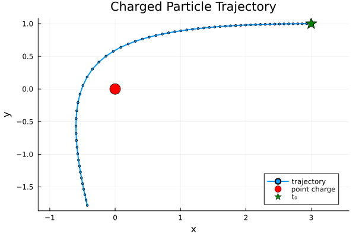
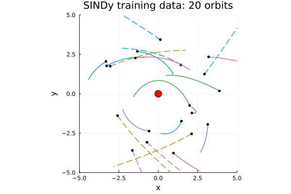
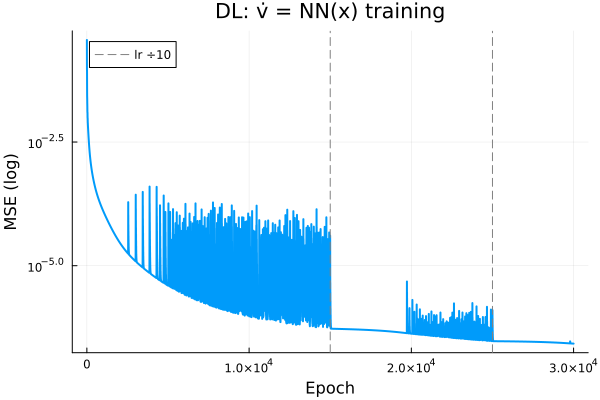
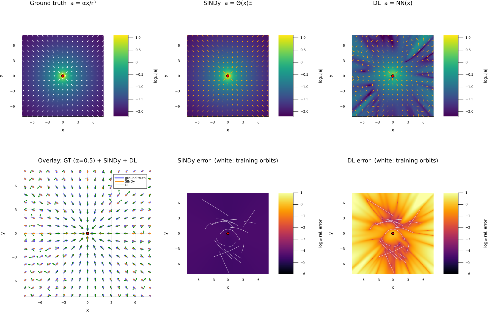
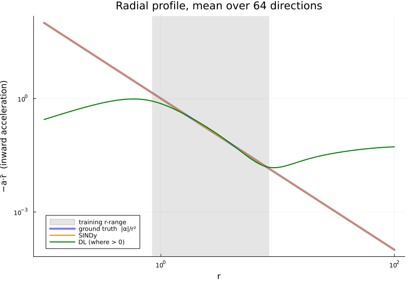
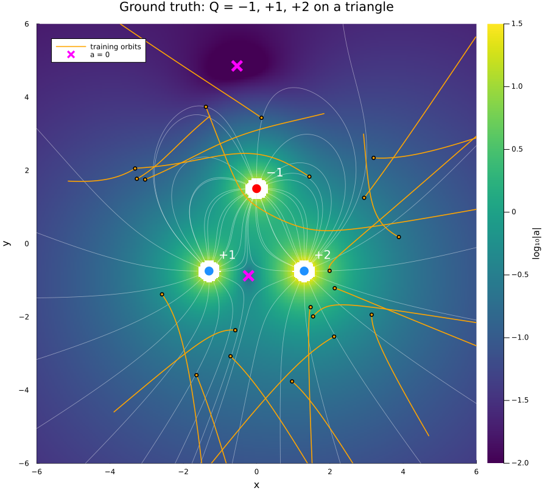
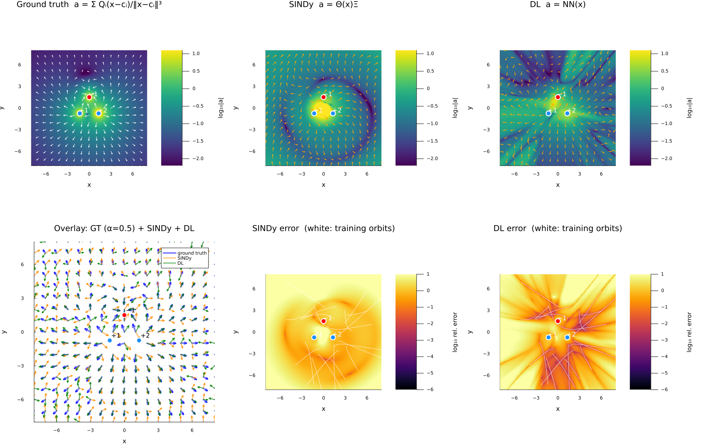

# Dynamics Identification for Coulomb's Law

Given observed motion of a test particle near a fixed charge, identify the dynamics
$\frac{d}{dt}\boldsymbol v = \boldsymbol a(\boldsymbol x)$. The approach is to regress $\boldsymbol a$ on
$(\boldsymbol x_k, \dot{\boldsymbol v}_k)$ samples twice, once with a sparse library (SINDy) and once with
a neural network (DL), and then compare what each learns inside and outside the data.

## Physics

A test particle (charge $q$, mass $m$) near a fixed charge $Q$ at the origin:

$$\begin{aligned}
\boldsymbol F &= \frac{kqQ}{r^2}\hat{\boldsymbol x}  \\
& = \frac{kqQ}{r^3}\boldsymbol x \\
\frac{d}{dt}\boldsymbol v & = \alpha \frac{\boldsymbol x}{r^3}\\
\end{aligned}$$

## Ground-truth trajectory

Attractive charge, $\alpha = -1$. Start at $\boldsymbol x_0 = (3, 1)$, $\boldsymbol v_0 = (-1, 0)$, and
integrate with Tsit5 over $t\in[0,4]$, saving 60 samples.

Run: `julia --project src/trajectory.jl`

## Dataset

### One trajectory is not enough

Regressing on the single ground-truth trajectory above fails. With the SINDy library
$\Theta(\boldsymbol x)$ (15 terms, defined in the next section), the column-normalized $\Theta$ has four
singular values between $10^{-13}$ and $10^{-11}$, and STLSQ returns coefficients of order
$10^4$–$10^7$ that fit perfectly and mean nothing. The cause is the orbit's geometry. A Coulomb orbit
is a conic with its focus at the charge, and the focus–directrix property makes $r$ *linear* in
position:

$$r + \boldsymbol e\cdot\boldsymbol x = p\qquad(\boldsymbol e\text{ the eccentricity vector},\ p\text{ the semi-latus rectum})$$

That single identity yields four exact linear relations among the library columns:

$$\begin{aligned}
(p - \boldsymbol e\cdot\boldsymbol x)^2 &= x^2 + y^2 && \text{(the conic: } 1, x, y, x^2, xy, y^2) \\
p\,\tfrac{1}{r} - e_x\tfrac{x}{r} - e_y\tfrac{y}{r} &= 1 \\
p\,\tfrac{1}{r^2} - e_x\tfrac{x}{r^2} - e_y\tfrac{y}{r^2} &= \tfrac{1}{r} \\
p\,\tfrac{1}{r^3} - e_x\tfrac{x}{r^3} - e_y\tfrac{y}{r^3} &= \tfrac{1}{r^2}
\end{aligned}$$

In particular the last one lets $x/r^3$, the true term, be traded for other columns at no cost.
The fix is to vary the orbits. Across many orbits, $\boldsymbol e$ and $p$ differ from orbit to orbit, so the
relations no longer hold on the whole dataset, and the null space disappears. That is how the
dataset is built.

### 20 orbits

There are 20 trajectories, all with the same physics ($\alpha=-1$, $t\in[0,4]$) and different
initial conditions:

$$\theta_0\sim\mathcal U[0,2\pi),\quad r_0\sim\mathcal U[2,4],\quad v_{x},v_{y}\sim\mathcal N(0,\,0.8^2)$$

Orbits with $r_{\min} \le 0.3$ are rejected. The targets $\dot{\boldsymbol v}$ come from central
differences of the sampled velocity, $\dot{\boldsymbol v}_k \approx (\boldsymbol v_{k+1}-\boldsymbol v_{k-1})/2\Delta t$
with $\Delta t = 0.01$. All samples are stacked into one dataset of $(\boldsymbol x_k, \dot{\boldsymbol v}_k)$
pairs, $N = 20\times 399 = 7980$. For SINDy that means $\Theta = [\Theta^{(1)};\dots;\Theta^{(20)}]$. The set has
12 ellipses ($E<0$, solid) and 8 hyperbolas ($E>0$, dashed), with $e\in[0.21,\,6.6]$ and $L$ of
both signs. Each is a short arc of a different conic.

SINDy and DL are both fit to exactly this dataset.

## SINDy

The true dynamics are

$$\frac{d}{dt}\boldsymbol v = \alpha\frac{\boldsymbol x}{r^3}, \qquad r = \lVert\boldsymbol x\rVert$$

The unknown is the acceleration as a function of position. So regress $\dot{\boldsymbol v}$ on a library of
position terms and learn the coefficients $\Xi$:

$$\dot{\boldsymbol v}^\top = \Theta(\boldsymbol x)\,\Xi,\qquad \Xi\in\mathbb R^{15\times 2}$$

**Library** (15 terms):

$$\Theta(\boldsymbol x) = \big[\ \boldsymbol 1 \ \big|\ \Theta_{\text{lin}}\ \big|\ \Theta_{\text{nonlin}}\ \big]$$

$$\begin{aligned}
\Theta_{\text{lin}} &= [\ x,\ y\ ] \\
\Theta_{\text{nonlin}} &= \Big[\ x^2,\ xy,\ y^2\ \Big|\ \tfrac{1}{r^n},\ \tfrac{x}{r^n},\ \tfrac{y}{r^n}\ \Big]_{n=1,2,3}
\end{aligned}$$

That is 1 constant, 2 linear terms, 3 quadratic terms and 9 rational terms, all evaluated per sample, so $\Theta\in\mathbb R^{N\times 15}$.

**Coefficients.** $\Xi$ is partitioned by rows to match the column blocks of $\Theta$. Column 1 of
$\Xi$ gives $\dot v_x$ and column 2 gives $\dot v_y$:

$$\Xi = \begin{bmatrix}
\boldsymbol\xi_0 \\
\Xi_{\text{lin}} \\
\Xi_{\text{nonlin}}
\end{bmatrix},\qquad
\boldsymbol\xi_0\in\mathbb R^{1\times 2},\quad
\Xi_{\text{lin}}\in\mathbb R^{2\times 2},\quad
\Xi_{\text{nonlin}}\in\mathbb R^{12\times 2}$$

$$\dot{\boldsymbol v}^\top = \boldsymbol 1\,\boldsymbol\xi_0 + \Theta_{\text{lin}}\,\Xi_{\text{lin}} + \Theta_{\text{nonlin}}\,\Xi_{\text{nonlin}}$$

The truth has $\boldsymbol\xi_0 = \boldsymbol 0$ and $\Xi_{\text{lin}} = \boldsymbol 0$. In $\Xi_{\text{nonlin}}$
only two entries are nonzero: row $x/r^3$, column $\dot v_x$, and row $y/r^3$, column $\dot v_y$,
both equal to $\alpha$.

**Fit:** STLSQ with threshold $\lambda = 0.05$. That is least squares, then zero every
$|\xi_{ij}| < \lambda$, then refit on the surviving terms, repeated.

**Regressed** $\Xi$. All other 13 rows are exactly zero:

| term | $\dot v_x$ | $\dot v_y$ |
|---|---:|---:|
| $x/r^3$ | $-1.0000$ | |
| $y/r^3$ | | $-1.0000$ |

$$\dot v_x = -1.0000\,\frac{x}{r^3},\qquad \dot v_y = -1.0000\,\frac{y}{r^3}
\quad\Longrightarrow\quad \hat\alpha = -1.0000$$

The residual RMS is $8\times10^{-6}$, the finite-difference error.

Run: `julia --project src/sindy.jl`

## DL

The same regression, with no library: replace $\Theta(\boldsymbol x)\,\Xi$ with a neural network and fit
it to the same $(\boldsymbol x_k, \dot{\boldsymbol v}_k)$ pairs from the same 20 orbits:

$$\frac{d}{dt}\boldsymbol v = \mathrm{NN}_\theta(\boldsymbol x),\qquad
\mathcal L(\theta) = \frac1N\sum_{k=1}^{N}\big\lVert \dot{\boldsymbol v}_k - \mathrm{NN}_\theta(\boldsymbol x_k)\big\rVert^2$$

This is plain supervised regression, with no ODE solver.

- **Network:** MLP $2\to64\to64\to2$, $\tanh$ hidden layers, linear output, 4482 parameters.
- **Training:** full batch ($N = 7980$), Adam with step decay of the learning rate,
  $10^{-3}\to10^{-4}\to10^{-5}$ at epochs 15k and 25k, for 30k epochs. Final MSE is
  $2.7\times10^{-7}$.
- **Training coverage:** the orbits span $r\in[0.84,\ 8.46]$, though only sparsely toward the
  outer end.

A training MSE of $3\times10^{-7}$ says the network fits the data. It says nothing about the field
away from the data. That is the next section.

Run: `julia --project src/dl.jl` (~7 min on CPU)

## Learned Acceleration Field

All three fields $\boldsymbol a(\boldsymbol x)$ on $[-8,8]^2$, twice the extent of the training starts, so
most of the plane is **out of sample**. Top row: ground truth, SINDy, DL. Each background is
$\log_{10}\lvert\boldsymbol a\rvert$ of that panel's own field, and arrow length is proportional to
$\log\lvert\boldsymbol a\rvert$. Bottom row: the overlay (ground truth at opacity 0.5, with SINDy and DL on
top), then the log relative error
$\lVert\boldsymbol a-\boldsymbol a_{\text{gt}}\rVert/\lVert\boldsymbol a_{\text{gt}}\rVert$ of SINDy and of DL,
with the training orbits drawn in white.

The radial profile is the inward acceleration $-\boldsymbol a\cdot\hat{\boldsymbol r}$, averaged over 64
directions, out to $r = 100$. The grey band is the training $r$-range.

Median relative error by region:

| region | SINDy | DL |
|---|---:|---:|
| $r < 0.84$ (inside the closest approach) | $3\times10^{-5}$ | $0.70$ |
| $0.84 \le r \le 4$ (covered by training) | $3\times10^{-5}$ | $0.05$ |
| $r > 4$ | $3\times10^{-5}$ | $1.2$ |
| $r > 8$ | $3\times10^{-5}$ | $3.8$ |

Inward acceleration along the radius:

| $r$ | ground truth $\lvert\alpha\rvert/r^2$ | SINDy | DL |
|---:|---:|---:|---:|
| 0.3 | 10.9 | 10.9 | 0.74 |
| 1 | 0.985 | 0.985 | 0.73 |
| 3 | 0.112 | 0.112 | 0.120 |
| 10 | 0.0102 | 0.0102 | 0.0150 |
| 30 | 0.0011 | 0.0011 | 0.036 |
| 100 | 0.0001 | 0.0001 | 0.053 |

**Where DL fails.** Inside the data, along the white orbits, DL is accurate to a few percent.
Off the orbits it fails in two predictable ways:

- **Near the charge** ($r < 0.84$, never sampled), the network has no way to produce the
  $1/r^2$ blow-up. A $\tanh$ MLP is bounded, so it rolls over and *decreases*: 0.74 at
  $r = 0.3$ against a true value of 10.9.
- **Far away**, every $\tanh$ unit saturates, so $\mathrm{NN}_\theta(\boldsymbol x)$ tends to a constant
  that depends only on direction. The profile flattens near 0.05 instead of decaying like
  $r^{-2}$. At $r = 100$ it is 500 times too large. The error map shows the same thing in 2-D:
  low error in a web along the training orbits, high error between and beyond them.

SINDy's error is a flat $3\times10^{-5}$ everywhere, inside and outside the data, because the term
it selected, $x/r^3$, is the law itself and is valid at every $r$. The network fits the training
data about as well, with MSE $3\times10^{-7}$ against SINDy's $7\times10^{-11}$. The difference is
entirely in what each model assumes where there is no data.

Run: `julia --project src/compare.jl` (after `sindy.jl` and `dl.jl`)

## 3 Charge Network

Replace the single charge with three fixed charges on an equilateral triangle of circumradius 1.5,
centred on the origin. With a unit test charge and $k/m = 1$, each $\alpha_i = Q_i$:

$$\frac{d}{dt}\boldsymbol v = \sum_{i=1}^{3} Q_i\,\frac{\boldsymbol x - \boldsymbol c_i}{\lVert\boldsymbol x - \boldsymbol c_i\rVert^3}$$

| charge | position | effect on the test particle |
|---:|---|---|
| $Q_1 = -1$ | $(0,\ 1.5)$ | attracts |
| $Q_2 = +1$ | $(-1.30,\ -0.75)$ | repels |
| $Q_3 = +2$ | $(1.30,\ -0.75)$ | repels |

The background is $\log_{10}\lVert\boldsymbol a\rVert$, white lines are field lines, orange lines are 20
orbits from the same sampling recipe as the single-charge dataset, and magenta crosses mark
$\boldsymbol a = \boldsymbol 0$.

- **Near field:** field lines leave the two positive charges, and many of them end on $Q_1$.
- **Far field:** the net charge is $\sum_i Q_i = +2$, so at large distance the field looks like one
  repulsive charge. The dipole moment $\sum_i Q_i\boldsymbol c_i = (1.30,\ -3.75)$ puts its effective
  centre at $(0.65,\ -1.88)$, not at the origin.
- **Null points:** $\boldsymbol a = \boldsymbol 0$ at $(-0.22,\ -0.88)$, between the positive charges, and at
  $(-0.54,\ 4.85)$, where the attraction of $Q_1$ cancels the net repulsion.

Most of these orbits stay outside the triangle, and none enters the region between the charges.

Run: `julia --project src/three_charges_gt.jl`

### Learned Acceleration Field

All three fields on $[-8,8]^2$, with SINDy using the same 15-term library and DL an MLP
$2\to64\to64\to2$, both fit to these 20 orbits. Top row: ground truth, SINDy, DL. Each background is
$\log_{10}\lVert\boldsymbol a\rVert$ of that panel's own field, and arrow length is proportional to
$\log\lVert\boldsymbol a\rVert$. Bottom row: the overlay (ground truth at opacity 0.5, with SINDy and DL on
top), then the log relative error of SINDy and of DL, with the training orbits in white. On 10
held-out orbits, the median relative error is 108% for SINDy and 58% for DL.

Run: `julia --project src/three_charges.jl`

### Conclusion

Both models miss **superposition**, the structure of the true field:

$$\boldsymbol a(\boldsymbol x) = \sum_i Q_i\,\boldsymbol f(\boldsymbol x - \boldsymbol c_i),\qquad \boldsymbol f(\boldsymbol u) = \frac{\boldsymbol u}{\lVert\boldsymbol u\rVert^3}$$

Neither has one law $\boldsymbol f$ applied at several centres. The SINDy library holds terms centred only
on the origin, and the MLP is a single function of $\boldsymbol x$.

- **DL:** a rich enough network, given enough orbits, may memorize this particular layout, with the
  charges baked into its weights. That would be a good field for this arrangement, not a law: move
  a charge and it has to be retrained. Capacity alone is not enough here. With 20 orbits, a larger
  $3\times128$ network reached a training MSE of $5\times10^{-8}$ and a held-out MSE of $0.23$.
- **SINDy:** the fix is to experiment with additions to the library. If the centres are known, adding
  $(\boldsymbol x-\boldsymbol c_i)/\lVert\boldsymbol x-\boldsymbol c_i\rVert^3$ makes the problem linear in $Q_i$. If
  they are unknown, the $\boldsymbol c_i$ enter nonlinearly, so they have to be searched for rather than
  regressed.
